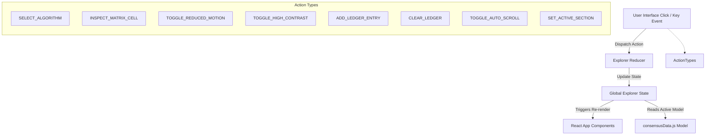

# Architecture Specification: Blockchain Consensus Explorer

This document details the production-grade frontend architecture for the educational application **"Consensus Algorithms in Blockchain — A Comparative Explorer"**. 

---

## 1. Folder Structure

The project employs a component-driven React architecture designed for performance, modularity, and easy extension.

```
blockchain/
├── index.html                  # Root HTML entrypoint with viewport & font loader
├── package.json                # Project script, React, and build configurations
├── tailwind.config.js          # Design token and theme registry
├── postcss.config.js           # PostCSS Tailwind processing
├── vite.config.js              # Vite server & React bundling rules
├── ARCHITECTURE.md             # This structural specification document
└── src/
    ├── main.jsx                # DOM mounting entrypoint
    ├── App.jsx                 # Page coordinator, resizing split, & shortcut listeners
    ├── index.css               # Base Tailwind, scrollbar, & custom transitions
    ├── constants/
    │   └── consensusData.js    # Normalized consensus & 16-chain matrix datasets
    ├── context/
    │   └── ExplorerContext.jsx # useReducer & Context provider for global state
    ├── components/
    │   ├── common/
    │   │   ├── Header.jsx      # Fixed top header bar & accessibility overrides
    │   │   ├── SelectorBar.jsx # Sticky, keyboard-navigable workspace view navigation
    │   │   └── WorkflowEngine.jsx # Reusable, progress-tracked consensus timeline
    │   ├── canvas/
    │   │   ├── RadarChartCanvas.jsx # requestAnimationFrame trilemma radar
    │   │   └── SimulationEngine.jsx # Reusable blockchain protocol simulation engine
    │   ├── panels/
    │   │   ├── ProtocolMechanics.jsx  # Plain-text overview & timeline steps
    │   │   ├── TrilemmaScorecard.jsx  # Score indicators and radar wrapper
    │   │   ├── ImplementationGrid.jsx # Smart contract engines & chain targets
    │   │   ├── CompatibilityMatrix.jsx # 16x16 interactive table matrix
    │   │   └── AttackSimulator.jsx    # Dynamic attack vectors details & parameters
    │   └── layout/
    │       ├── Sidebar.jsx            # Permanent Left Sidebar for Algorithm Selection
    │       ├── RightLedgerPanel.jsx   # Resizable Immutable Ledger Panel
    │       └── BottomStrip.jsx        # Persistent system telemetry status bar
```

---

## 2. Design Tokens, Spacing & Typography

### Design Tokens
Our design palette matches a dark protocol control center, utilizing standard HSL/Hex bindings for each consensus family:

* **Nakamoto Family**: `#f59e0b` (Amber/Gold glow for PoW, PoH)
* **Staking Family**: `#8b5cf6` (Violet/Purple glow for PoS, DPoS)
* **Byzantine Family**: `#06b6d4` (Cyan/Teal glow for PBFT)
* **Authority Family**: `#10b981` (Emerald/Green glow for PoA)
* **TEE Family**: `#34d399` (Mint/Green glow for PoET)
* **Avalanche Family**: `#f43f5e` (Rose/Red glow for Avalanche)

### Spacing System
Adheres to a strict 4px/8px layout grid to maintain structural harmony:
* `p-2` / `gap-2` = 8px (Inner elements)
* `p-4` / `gap-4` = 16px (Card components)
* `p-6` / `gap-6` = 24px (Grid blocks)
* `py-10` / `mb-8` = 40px/32px (Layout boundaries)

### Typography
* **UI/Headers**: **Outfit** (geometric, highly readable, weight 300 to 800)
* **Metrics/Log/Code**: **JetBrains Mono** (monospace, weight 400 to 700)

---

## 3. State Management & Data Flow

Global state is controlled using React Context + `useReducer` to prevent props-drilling while avoiding complex third-party libraries (Zundand/Redux).



### State Structure:
```javascript
const initialState = {
  selectedAlgo: "pow",           // Active consensus ID
  activeSection: "dashboard",    // Active nav layout section ID
  matrixInspect: {
    chainA: null,                // Selected Row Blockchain model
    chainB: null,                // Selected Column Blockchain model
  },
  reducedMotion: false,          // Accessibility: Motion preferences
  highContrast: false,           // Accessibility: High Contrast overrides
  ledger: [],                    // Global Immutable Ledger array
  autoScroll: true,              // Autoscroll toggle
}
```

---

## 4. Theme System & Dynamic Transition

To execute page-wide theme changes when users select different algorithms, we bridge React state to CSS custom properties. When `SELECT_ALGORITHM` is dispatched, the reducer updates standard CSS variables:

```javascript
const updateAccentCSS = (algoId) => {
  const algo = consensusData[algoId]
  if (algo) {
    document.documentElement.style.setProperty("--accent-color", algo.color)
    document.documentElement.style.setProperty("--accent-glow", algo.glow)
  }
}
```

In `src/index.css`, utility classes reference these custom properties:
* `.dynamic-accent-text`: binds color change transitions.
* `.dynamic-accent-border`: controls timeline and node outlines.
* `.dynamic-accent-bg`: fills progress loader widths.
* `.dynamic-accent-shadow`: updates backdrops with family-themed glow.

---

## 5. Canvas & Animation Architecture

### RadarChartCanvas
The Blockchain Trilemma Radar chart renders dynamically on HTML5 Canvas.
* **Math Formulas**: Maps angles at $-90^\circ$ (Scalability), $30^\circ$ (Security), and $150^\circ$ (Decentralization) with coordinates centered at $(110, 110)$ and a max radius of $80\text{px}$.
* **Interpolation Easing**: Over a 400ms interval, `requestAnimationFrame` interpolates active scores using a Cubic Ease-Out curve:
  $$f(t) = 1 - (1 - t)^3$$
* **High-DPI Scaling**: Uses `window.devicePixelRatio` multipliers to adjust the canvas coordinate system, preventing blurry rendering on Retina screens.

### SimulationEngine
Exposes a unified simulation harness that runs custom visual simulations for all 8 consensus paradigms using standard HTML5 Canvas under `requestAnimationFrame`.
* **API Bindings**: Exposes reactive binds for controls:
  * **Play/Pause**: Suspends or resumes the active canvas frame updates.
  * **Reset**: Returns loop index counters to zero and clears transient graphic particles.
  * **Speed**: Multiplies progress frame rates ($1\times, 2\times, 5\times$) for fast traversal.
  * **Simulation Progress**: Percentage ticker ($0\% - 100\%$) indicating consensus round progression.
  * **Simulation Status**: Badge displaying the active step state (e.g. INGESTING, COMPUTING, AUDITING).
  * **Simulation Logs**: Dynamic auto-scrolling terminal window displaying timestamped protocol events.
* **Paradigm Visualizations**:
  * **Nakamoto**: Progress bars compute hash calculations, triggering ripple syncs when blocks are found.
  * **Staking**: Circular rings of validators attesting blocks with variable staking ratios.
  * **Byzantine**: Multicast packets showing all-to-all communication round delays.
  * **Authority**: Signers passing active block authorizations in sequence.
  * **TEE**: Nodes entering low-power sleep cycles awaiting hardware countdown timers.
  * **Avalanche**: Leaderless sub-sampling sweeps transferring node opinions recursively.

---

## 6. Accessibility (A11y) Plan

### Keyboard Navigation & Hotkeys
* **Grid Traversal**: The 16x16 interoperability matrix captures arrow keys to shift cell selection coordinates, allowing full grid traversal. Enter and Space keys inspect selected cells.
* **Layout Navigation Shortcuts**: To facilitate quick traversal between control center workspaces without mouse operations, global window listeners register the `Alt + [1-6]` hotkeys:
  * `Alt + 1` -> Switches workspace to **Dashboard**
  * `Alt + 2` -> Switches workspace to **Protocol Mechanics**
  * `Alt + 3` -> Switches workspace to **Trilemma Analysis**
  * `Alt + 4` -> Switches workspace to **Live Simulations**
  * `Alt + 5` -> Switches workspace to **Ecosystem & Languages**
  * `Alt + 6` -> Switches workspace to **Compatibility Matrix**

### Reduced Motion Strategy
* We hook into browser settings via `window.matchMedia("(prefers-reduced-motion: reduce)")` to set the initial `reducedMotion` state.
* The Canvas animation loops listen to `reducedMotion` to skip duration steps, disabling transitions and rendering static frame snapshots instantly.

---

## 7. Panel Resizing Architecture
The boundary between the Middle Main Workspace and the Right Immutable Ledger Panel is resizable:
1. A vertical splitter handle captures `mousedown` triggers, binding dynamic `mousemove` listener extensions directly to the browser window document.
2. During drag actions, calculations compute the offset from the screen boundary:
   $$\text{width}_{\text{ledger}} = \text{innerWidth}_{\text{window}} - \text{clientX}_{\text{mouse}}$$
3. Values are clamped within bounds ($220\text{px} \le \text{width} \le 500\text{px}$) and written to local React state, adjusting the CSS width parameters.
4. On release (`mouseup`), listeners are detached to avoid memory overheads.
